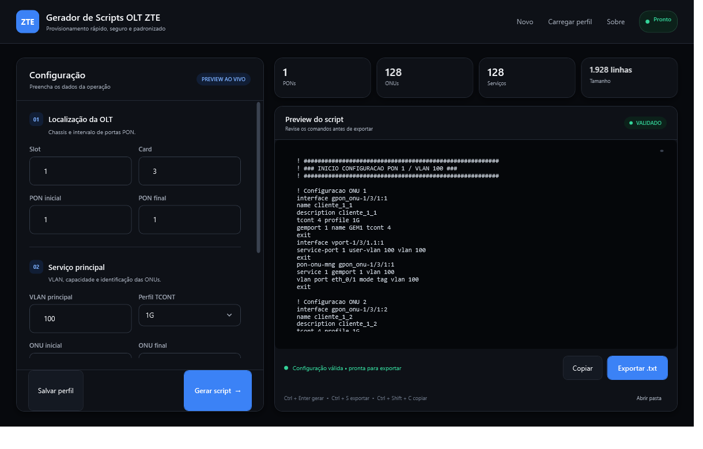

<div align="center">

# Gerador de Scripts OLT ZTE

### Provisionamento de rede com menos trabalho manual e mais segurança

[](https://dotnet.microsoft.com/)
[](https://learn.microsoft.com/dotnet/desktop/wpf/)
[](#arquitetura)
[](https://github.com/rafaelcairess/Gerador-Script-OLT-ZTE/actions/workflows/qualidade.yml)
[](LICENSE)

Aplicação desktop nativa para gerar, validar e exportar scripts de
provisionamento de OLTs ZTE Titan.

</div>



## O problema

Ativações, migrações e manutenções de rede podem exigir centenas de comandos
parecidos. Editar esses blocos manualmente consome tempo e aumenta a
possibilidade de erros em intervalos de PON, ONUs, VLANs e identificadores.

O Gerador de Scripts OLT ZTE transforma os parâmetros da operação em um script
padronizado e pronto para revisão. Uma única configuração pode contemplar até
**16 PONs e 2.048 ONUs**.

## Principais recursos

- Geração em lote por intervalos de PON e ONU
- VLAN principal e serviço adicional para VoIP ou IPTV
- Perfis TCONT e nomes GEM configuráveis
- Validação imediata de intervalos, VLANs e identificadores
- Pré-visualização do script com métricas da operação
- Cabeçalho e rodapé personalizados
- Perfis reutilizáveis em JSON
- Compatibilidade com perfis criados em versões anteriores
- Cópia para a área de transferência e exportação em `.txt`
- Atalhos de teclado e interface escura, responsiva e minimalista
- Executável único e autossuficiente para Windows x64

## Destaques de engenharia

Este projeto foi estruturado como uma aplicação de produção, não apenas como
uma demonstração visual:

- C# e .NET 8 com Nullable Reference Types
- WPF com separação de responsabilidades usando MVVM
- Princípios SOLID e inversão de dependência
- Núcleo independente de interface, arquivos e APIs do Windows
- Validações de domínio e mensagens de erro voltadas ao operador
- Testes automatizados com xUnit e relatório de cobertura
- Analisadores estáticos com avisos tratados como erros
- Build, testes e publicação automatizados pelo GitHub Actions
- Executável distribuído sem exigir instalação separada do .NET

## Arquitetura

A solução separa regras de negócio, integrações e interface gráfica em projetos
independentes:

| Projeto | Responsabilidade |
|---|---|
| `GeradorOlt.Nucleo` | Geração dos comandos, modelos, contratos e validações |
| `GeradorOlt.Infraestrutura` | Persistência de perfis e exportação de arquivos |
| `GeradorOlt.Apresentacao` | Interface WPF, estado da tela e integração com Windows |
| `GeradorOlt.Testes` | Testes do núcleo, infraestrutura e apresentação |

```text
Interface WPF
     │
     ▼
Modelos de visão
     │
     ▼
Contratos do núcleo ◄──── Infraestrutura
```

O núcleo não conhece WPF, JSON ou detalhes do Windows. Isso permite testar as
regras de geração isoladamente e trocar implementações externas sem alterar a
lógica principal.

Veja as decisões técnicas em
[`documentacao/ARQUITETURA.md`](documentacao/ARQUITETURA.md).

## Estrutura do projeto

```text
src/
├── GeradorOlt.Nucleo/
│   ├── Exportacao/
│   ├── Geracao/
│   ├── Modelos/
│   ├── Perfis/
│   └── Validacao/
├── GeradorOlt.Infraestrutura/
│   ├── Exportacao/
│   └── Perfis/
└── GeradorOlt.Apresentacao/
    ├── Infraestrutura/
    ├── ModelosVisao/
    ├── Servicos/
    ├── Telas/
    └── Temas/
testes/
└── GeradorOlt.Testes/
```

## Como executar

### Pelo Visual Studio

1. Abra [`GeradorScriptsOltZte.sln`](GeradorScriptsOltZte.sln).
2. Defina `GeradorOlt.Apresentacao` como projeto de inicialização.
3. Pressione `F5`.

### Pelo terminal

Requer Windows e
[.NET 8 SDK](https://dotnet.microsoft.com/download/dotnet/8.0).

```powershell
git clone https://github.com/rafaelcairess/Gerador-Script-OLT-ZTE.git
cd Gerador-Script-OLT-ZTE
dotnet run --project .\src\GeradorOlt.Apresentacao
```

## Testes e qualidade

```powershell
dotnet build GeradorScriptsOltZte.sln --configuration Release
dotnet test GeradorScriptsOltZte.sln --configuration Release
```

Os testes cobrem geração por intervalos, segundo serviço, métricas,
normalização de identificadores, entradas inválidas, compatibilidade JSON,
exportação UTF-8 e comportamento dos modelos de visão.

Integrações como área de transferência e caixas de diálogo são representadas
por implementações controladas durante os testes. Assim, a lógica da interface
pode ser verificada automaticamente sem abrir janelas ou alterar dados do
computador.

## Gerar o executável

```powershell
dotnet publish .\src\GeradorOlt.Apresentacao `
  --configuration Release `
  --runtime win-x64 `
  --self-contained true `
  -p:PublishSingleFile=true `
  -p:IncludeNativeLibrariesForSelfExtract=true `
  --output .\publicacao
```

O arquivo `publicacao\GeradorOlt-ZTE.exe` pode ser executado diretamente em
Windows x64.

> Scripts de rede devem ser revisados e validados em ambiente controlado antes
> da aplicação em produção.

---

Desenvolvido por **Rafael Caires & Lucas Alexandre**.
