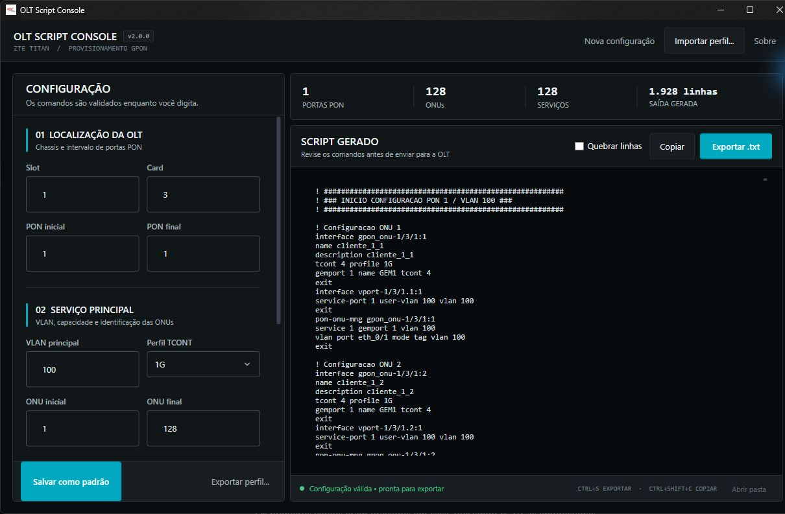

<div align="center">

# Gerador de Scripts OLT ZTE

**Provisionamento de ONUs ZTE Titan com validação local e geração em lote.**

[](https://github.com/rafaelcairess/Gerador-Script-OLT-ZTE/actions/workflows/qualidade.yml)
[](https://dotnet.microsoft.com/)
[](LICENSE)

[Baixar para Windows](https://github.com/rafaelcairess/Gerador-Script-OLT-ZTE/releases) ·
[Ver arquitetura](documentacao/ARQUITETURA.md) ·
[Consultar parâmetros](#parâmetros-aceitos)

</div>

Aplicação desktop que transforma parâmetros de rede em scripts de
provisionamento para OLTs ZTE Titan. O operador configura PONs, ONUs, VLANs e
perfis de serviço; o aplicativo valida os dados localmente e mantém o resultado
pronto para revisão, cópia ou exportação.

> [!IMPORTANT]
> A validação feita pelo aplicativo verifica formatos, intervalos e consistência
> dos parâmetros. Ela não substitui a revisão técnica nem um teste controlado na
> versão de firmware da OLT de destino.



<p align="center"><sub>Configuração validada à esquerda e script pronto para revisão à direita.</sub></p>

## Fluxo de trabalho

| 1. Configurar | 2. Validar | 3. Exportar |
|---|---|---|
| Informe slot, card, PONs, ONUs e VLANs. | O preview e as métricas são atualizados durante a digitação. | Revise, copie ou gere o arquivo `.txt`. |

## Funcionalidades

- geração para intervalos de PON e ONU;
- serviço principal e segundo serviço opcional para VoIP ou IPTV;
- perfis TCONT e nomes GEM configuráveis;
- console de operação com preview atualizado durante o preenchimento;
- validação por campo e resumo de PONs, ONUs, serviços e linhas;
- quebra de linhas opcional para revisar scripts extensos;
- perfis reutilizáveis e versionados em JSON;
- compatibilidade com perfis JSON legados;
- exportação UTF-8 sem BOM e gravação atômica;
- atalhos de teclado e suporte a leitores de tela;
- executável único e autossuficiente para Windows x64.

## Usar o aplicativo

1. Baixe `GeradorOlt-ZTE.exe` na página de
   [Releases](https://github.com/rafaelcairess/Gerador-Script-OLT-ZTE/releases).
2. Execute o arquivo no Windows 10 ou 11 x64.
3. Informe a localização da OLT, as VLANs e o intervalo de ONUs.
4. Confirme o status verde na barra inferior e revise o preview.
5. Copie o resultado ou use **Exportar .txt**.

O executável é autossuficiente: não é necessário instalar o .NET separadamente.

### Atalhos

| Atalho | Ação |
|---|---|
| `Ctrl` + `Enter` | Validar e gerar imediatamente |
| `Ctrl` + `S` | Exportar o script |
| `Ctrl` + `Shift` + `C` | Copiar o script |

## Parâmetros aceitos

| Parâmetro | Valores |
|---|---|
| Slot | 1 a 99 |
| Card | 1 a 99 |
| PON | 1 a 16 |
| ONU | 1 a 128 por PON |
| VLAN | 1 a 4094 |
| Perfil TCONT | `100M`, `200M`, `500M`, `1G`, `2G` ou `1GPON` |
| Prefixo e nomes GEM | Até 32 caracteres: letras, números, `.`, `_` e `-` |

Uma configuração pode gerar até 2.048 ONUs. A VLAN do segundo serviço deve ser
diferente da VLAN principal.

## Exemplo de saída

```text
interface gpon_onu-1/3/1:1
name cliente_1_1
description cliente_1_1
tcont 4 profile 1G
gemport 1 name GEM1 tcont 4
exit
interface vport-1/3/1.1:1
service-port 1 user-vlan 100 vlan 100
exit
pon-onu-mng gpon_onu-1/3/1:1
service 1 gemport 1 vlan 100
vlan port eth_0/1 mode tag vlan 100
exit
```

## Perfis JSON

Perfis preservam os campos exatamente como aparecem no formulário. Novos
arquivos recebem uma versão de formato; arquivos legados sem essa propriedade
continuam aceitos.

O aplicativo procura automaticamente `perfil_config.json` em:

```text
%AppData%\GeradorOltZte\perfil_config.json
```

Use **Salvar como padrão** para atualizar esse arquivo sem precisar escolher uma
pasta. A opção **Exportar perfil...** cria uma cópia JSON em qualquer local e
**Importar perfil...** abre um perfil existente.

Por compatibilidade, também procura o arquivo ao lado do executável. Perfis de
versões futuras são recusados com uma mensagem explícita, evitando uma leitura
parcial ou incorreta.

## Desenvolvimento

### Requisitos

- Windows;
- [.NET SDK 8.0.420](https://dotnet.microsoft.com/download/dotnet/8.0) ou patch
  posterior da mesma linha, conforme [`global.json`](global.json);
- Visual Studio 2022 ou outro editor com suporte a projetos WPF, opcional.

### Executar

```powershell
git clone https://github.com/rafaelcairess/Gerador-Script-OLT-ZTE.git
cd Gerador-Script-OLT-ZTE
dotnet run --project .\src\GeradorOlt.Apresentacao
```

### Compilar e testar

```powershell
dotnet restore GeradorScriptsOltZte.sln --locked-mode
dotnet build GeradorScriptsOltZte.sln --configuration Release --no-restore
dotnet test GeradorScriptsOltZte.sln --configuration Release --no-build
```

O pipeline executa build com avisos tratados como erros, os testes xUnit e a
coleta de cobertura. O mínimo atual é 70% de linhas e 65% de branches.

## Arquitetura

```text
GeradorOlt.Apresentacao  ──┐
                           ├──> GeradorOlt.Nucleo
GeradorOlt.Infraestrutura ─┘

GeradorOlt.Testes ──> todas as camadas
```

| Projeto | Responsabilidade |
|---|---|
| `GeradorOlt.Nucleo` | Regras, validação e geração dos comandos |
| `GeradorOlt.Infraestrutura` | Perfis JSON e exportação de arquivos |
| `GeradorOlt.Apresentacao` | Interface WPF, MVVM e integrações do Windows |
| `GeradorOlt.Testes` | Testes unitários e de integração entre camadas |

Mais detalhes estão em
[`documentacao/ARQUITETURA.md`](documentacao/ARQUITETURA.md).

## Publicação e integridade

Tags no formato `vMAJOR.MINOR.PATCH` iniciam o workflow de release. A versão da
tag é gravada no executável e a publicação só continua se o teste de
inicialização do artefato for aprovado.

Cada release inclui:

- `GeradorOlt-ZTE.exe`;
- `GeradorOlt-ZTE.exe.sha256` para conferência de integridade;
- assinatura Authenticode quando o certificado do projeto estiver configurado.

Para conferir o checksum no PowerShell:

```powershell
Get-FileHash .\GeradorOlt-ZTE.exe -Algorithm SHA256
Get-Content .\GeradorOlt-ZTE.exe.sha256
```

Os valores devem ser iguais.

## Licença

Distribuído sob a [licença MIT](LICENSE).

Desenvolvido por Rafael Caires e Lucas Alexandre.
